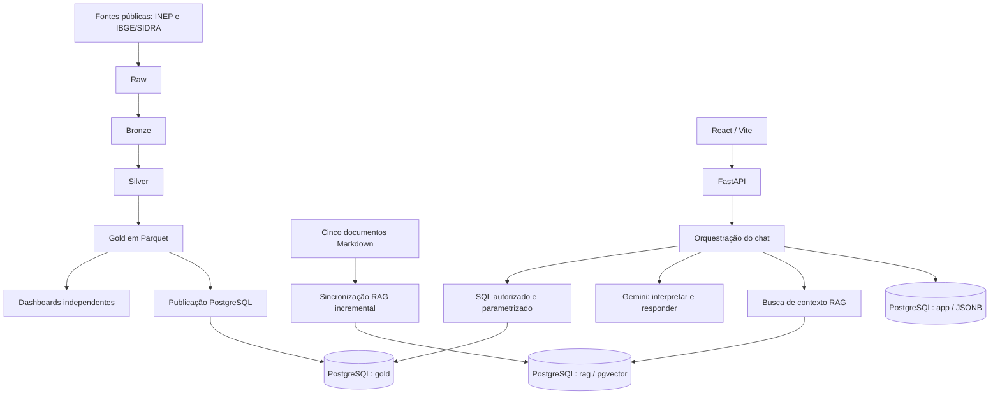

# EI DataBot

**EI DataBot** — plataforma experimental de engenharia de dados e consultas analíticas sobre a educação brasileira.

> **Estágio:** Alpha 1 (`v0.1.0-alpha.1`) · **Referência:** 03/11/2026 · **Estado:** desenvolvimento local, não preparado para exposição pública.
>
> Esta versão inclui a primeira integração funcional após a refatoração estrutural. A cobertura de indicadores, os testes funcionais, os controles de acesso e os dashboards continuam em desenvolvimento.

O projeto integra dados públicos de educação em um pipeline **Raw → Bronze → Silver → Gold**, com processamento em **Python/Polars**, armazenamento em **Parquet** e publicação de dados analíticos no **PostgreSQL**. Um chatbot em **React/TypeScript** consulta uma API **FastAPI** que interpreta perguntas com **Gemini**, executa apenas consultas SQL previamente autorizadas e explica os resultados obtidos no banco. As regras documentais são recuperadas por **RAG com pgvector**.

**Integração:** o chatbot e os dashboards compartilham a camada Gold produzida pelo ETL. O chatbot consulta as tabelas analíticas publicadas no PostgreSQL, enquanto os dashboards são gerados a partir dos arquivos Parquet Gold. O chatbot não consulta diretamente os dashboards.

## O que está disponível na Alpha 1

| Componente                       | Estado atual                                                                                                                                   |
| -------------------------------- | ---------------------------------------------------------------------------------------------------------------------------------------------- |
| ETL Medallion (`educacao`)       | 27 etapas concluídas com sucesso na execução integral validada durante a refatoração.                                                          |
| PostgreSQL Gold                  | Cinco dimensões e cinco tabelas fato, totalizando 2.702.972 registros publicados e validados.                                                  |
| RAG documental                   | Recuperação de contexto a partir de cinco documentos, com fragmentação, embeddings e sincronização incremental.                                |
| Backend FastAPI                  | Chat, interpretação estruturada Gemini, RAG auxiliar, SQL parametrizado e histórico PostgreSQL/JSONB implementados.                            |
| Indicadores liberados no chatbot | `CAT-EB-001` (matrículas da educação básica) e `CAT-ES-023` (matrículas da educação superior).                                                 |
| Frontend React                   | Consulta real ao backend, exibição de fontes, avisos e dados estruturados, continuidade de contexto, navegação e exclusão de conversas locais. |
| Histórico                        | Mensagens persistidas em `app.messages`; lista de sessões conhecidas pelo navegador, com restauração pelo UUID.                                |
| Dashboard                        | Criado de acordo com as regras de negócio e dados do ETL.                                                                                      |
| Segurança de acesso              | **Não concluída:** ainda não há autenticação/autorização de usuários nem isolamento de sessões por identidade.                                 |

## Arquitetura



### Responsabilidades dos schemas

| Schema | Responsabilidade                                                                                   |
| ------ | -------------------------------------------------------------------------------------------------- |
| `gold` | Fatos, dimensões e dados analíticos provenientes do ETL.                                           |
| `rag`  | Documentos, fragmentos, embeddings, versões, cache e catálogo técnico do Gold.                     |
| `app`  | Sessões UUID e mensagens JSONB, com exclusão em cascata das mensagens quando uma sessão é apagada. |

A LLM **não gera SQL livre** nem é a fonte dos números. O Python valida indicador, período, município, UF e operação antes de executar consultas parametrizadas. O RAG fornece contexto metodológico, sem autorizar novas operações ou indicadores.

## Escopo analítico do chatbot

| ID           | Indicador                       | Período previsto no contrato | Operações                   |
| ------------ | ------------------------------- | ---------------------------- | --------------------------- |
| `CAT-EB-001` | Matrículas da educação básica   | 2018–2025                    | `SOMA_ANUAL`, `SERIE_ANUAL` |
| `CAT-ES-023` | Matrículas da educação superior | 2018–2024                    | `SOMA_ANUAL`, `SERIE_ANUAL` |

**Limitações atuais:** o chatbot não compara dois municípios numa única solicitação, não habilita automaticamente todos os indicadores documentados e não soma matrículas de anos distintos como se fossem ocorrências acumuláveis. A consulta municipal requer UF para desambiguar o município. As restrições geográficas da modalidade EAD devem ser respeitadas nas análises da educação superior. Pedidos fora do contrato são recusados de forma controlada.

As respostas podem incluir `resposta`, `fontes`, `cidade`, `uf`, `tema`, `dados_brutos` e `avisos`. A apresentação dos avisos é separada do texto explicativo para evitar notas administrativas desnecessárias. Isso não substitui a revisão metodológica dos resultados.

### Distâncias geográficas

O ETL educacional calcula a distância geográfica em quilômetros entre os municípios e uma localidade de referência configurável em `etl/educacao/config.py`, utilizando as variáveis `CIDADE_REFERENCIA` e `UF_REFERENCIA`.

A dimensão Gold `dim_localidade` armazena esse resultado em `distancia_referencia_km`. O cálculo utiliza a fórmula de Haversine, representando a distância aproximada em linha reta entre coordenadas geográficas, e não a distância rodoviária.

Na configuração atualmente validada, a referência é Rio de Janeiro/RJ. Registros sem coordenadas ou sem localização municipal aplicável podem apresentar distância nula.

O dashboard já recebe os dados de distância, mas o filtro interativo por distância geográfica está reservado para uma versão posterior à Alpha 1.

## Documentação de negócio e operacional

O conteúdo canônico das regras está em `docs/`. **Somente os cinco primeiros documentos** participam da indexação RAG. Sincronizar o RAG não significa aprovar uma regra.

| Documento                                      | Assunto                                                                  |
| ---------------------------------------------- | ------------------------------------------------------------------------ |
| [Educação Superior](docs/educacao_superior.md) | Fontes, granularidade, matrículas, EAD e restrições territoriais.        |
| [Educação Básica](docs/educacao_basica.md)     | Censo Escolar, escolas, matrículas e limites de interpretação.           |
| [Avaliações](docs/avaliacoes.md)               | ENADE, CPC, IDD, IGC e regras metodológicas.                             |
| [Indicadores](docs/indicadores.md)             | Identificadores, métricas, operações e agregações autorizadas.           |
| [Regras Gerais](docs/regras_gerais.md)         | Contratos transversais, granularidade, rastreabilidade e uso do RAG.     |
| [Comandos](docs/comandos.md)                   | Guia operacional de ETL, PostgreSQL, validações e RAG; **não indexado**. |

### RAG incremental

A sincronização é conduzida por `postgres/sync_rag.py` e utiliza hashes de documentos e fragmentos, cache persistente de embeddings e controle de versões. O modelo documental é `gemini-embedding-001` com vetores de **768 dimensões**. Fragmentos inalterados são reutilizados; alterações geram apenas o trabalho incremental necessário.

```powershell
# Consultar alterações pendentes sem modificar o banco ou gerar embeddings
python -m postgres.sync_rag --dry-run

# Executar a sincronização incremental do RAG
python -m postgres.sync_rag
```

Documentos em revisão só entram na recuperação de teste quando habilitado explicitamente `RAG_INCLUDE_DRAFTS=true` ou a opção equivalente `--include-drafts` na CLI. O RAG não concede privilégios SQL nem aprova documentos automaticamente.

## Requisitos de desenvolvimento

- Windows ou Linux, ou outro ambiente compatível com Python e Docker.
- Python 3.13 e dependências do `pyproject.toml`.
- Node.js e npm compatíveis com as dependências declaradas em `frontend/package.json`.
- Docker Compose com PostgreSQL e a extensão pgvector, conforme a configuração local do projeto.
- Credenciais de desenvolvimento para PostgreSQL e Gemini, fornecidas por variáveis de ambiente locais **não versionadas**.

A configuração do backend é carregada de `.env` na raiz do projeto. Consulte os exemplos de ambiente presentes no repositório e configure apenas os valores necessários, como `POSTGRES_*`, `LLM_API_KEY`, `LLM_MODEL` e, para testes com documentação em revisão, `RAG_INCLUDE_DRAFTS`.

## Execução local

Execute os comandos a partir da raiz do repositório, salvo indicação diferente.

### 1. Instalar dependências Python

```powershell
python -m pip install -e ".[etl]"
python -m pip check
```

### 2. Iniciar PostgreSQL

```powershell
docker compose up -d postgres
```

Os schemas e migrações devem existir antes da operação da API. Para uma instalação nova, aplique os scripts de criação necessários na ordem documentada em [Comandos](docs/comandos.md); **não reaplique scripts indiscriminadamente a um banco já populado**.

### 3. ETL e sincronização analítica (quando necessário)

```powershell
# Visualizar as etapas sem executar
python .\main.py --plan

# Executar o pipeline completo somente quando necessário
python .\main.py --run
```

**Atenção:** `--run` executa o ETL, publica as tabelas Gold, sincroniza o catálogo e valida os resultados. Pode sobrescrever arquivos processados e substituir tabelas analíticas existentes. Não é necessário executar novamente `postgres.sync` ou `postgres.sync_catalog` após uma execução completa bem-sucedida. Consulte [Comandos](docs/comandos.md) para executar etapas individuais.

### 4. Backend FastAPI

Em um terminal com o ambiente Python ativo:

```powershell
python -m uvicorn chatbot.chatbot:app --host 127.0.0.1 --port 8000
```

Verifique a disponibilidade HTTP:

```powershell
python -m unittest discover -s tests -p 'test_*.py' -q
```

`/health` verifica a disponibilidade da aplicação HTTP, não a conexão com o banco ou a API Gemini.

### 5. Frontend React/Vite

Em outro terminal:

```powershell
npm --prefix .\frontend ci
npm --prefix .\frontend run dev
```

### 6. Testar uma consulta

Na interface, pergunte:

> Quantas matrículas da educação básica houve em Volta Redonda/RJ em 2025?

Depois, na mesma conversa:

> E em 2024?

A segunda pergunta deve preservar o indicador e a localidade. O resultado observado anteriormente foi de 56.498 matrículas em 2025 e 57.432 em 2024. São verificações de integração anteriores, não garantia de atualização dos dados em tempo real.

Também é possível consultar diretamente a API:

```powershell
$corpo = @{
    pergunta = 'Quantas matrículas da educação básica houve em Volta Redonda/RJ em 2025?'
    session_id = [guid]::NewGuid().ToString()
} | ConvertTo-Json

Invoke-RestMethod `
    -Uri 'http://127.0.0.1:8000/api/chat' `
    -Method Post `
    -ContentType 'application/json; charset=utf-8' `
    -Body ([System.Text.Encoding]::UTF8.GetBytes($corpo))
```

## Sessões e histórico

- Cada nova conversa recebe um UUID utilizado para identificar a sessão no backend.
- O histórico canônico das mensagens é persistido no PostgreSQL, no schema `app`.
- O frontend mantém uma lista local de sessões conhecidas pelo navegador, limitada a 50 entradas.
- Ao selecionar uma conversa anterior, o frontend recupera as mensagens pela API.
- É possível iniciar, alternar e excluir conversas. A exclusão confirmada pelo backend também remove as mensagens associadas.
- O histórico recuperado preserva mensagens, fontes e avisos, mas não reconstrói os dados analíticos brutos de respostas antigas.
- Não existe autenticação ou autorização por usuário nesta versão. O UUID não deve ser considerado um mecanismo de segurança.
- A aplicação destina-se ao desenvolvimento local e não deve ser exposta publicamente sem controles de acesso.

## Qualidade e verificações

### Python

```powershell
python -m ruff check chatbot etl dashboards health postgres tests main.py
python -m unittest discover -s tests -p 'test_*.py' -q
python -m pip check
python -m postgres.validate_gold --offline
python -m postgres.sync_rag --dry-run
```

A validação offline apresenta avisos para documentos com aprovação pendente.

Para executar a validação aprofundada com acesso ao PostgreSQL:

```powershell
python -m postgres.validate_gold --deep
```

### Frontend

```powershell
npm --prefix .\frontend run check
npm --prefix .\frontend audit --omit=dev
npm --prefix .\frontend audit
```

O comando `check` executa TypeScript, ESLint, testes JavaScript e build Vite. O comando `npm audit --omit=dev` verifica as dependências de produção, enquanto `npm audit` inclui também as dependências de desenvolvimento.

Atualizações de dependências devem considerar a compatibilidade com o projeto. O uso de `npm audit fix --force` pode introduzir alterações incompatíveis.

## Estrutura principal do repositório

```text
ei_databot/
├── chatbot/                # API FastAPI e serviços conversacionais
├── dashboards/             # Dashboards gerados a partir do Gold
├── data/                   # Dados locais não versionados
├── docs/                   # Regras de negócio e guia operacional
├── etl/                    # Pipeline Raw/Bronze/Silver/Gold
├── frontend/               # React, TypeScript e Vite
├── health/                 # Verificações de integridade
├── postgres/               # Gold, RAG, catálogo e histórico JSONB
├── tests/                  # Testes Python
├── main.py                 # Orquestrador principal do ETL
├── docker-compose.yml      # Infraestrutura local
├── pyproject.toml          # Dependências e configuração Python
├── .env.example            # Exemplo de configuração sem credenciais
├── LICENSE
└── README.md
```

## Limitações e pendências da Alpha 1

- Autenticação, autorização por usuário, isolamento de sessões, rate limiting e política de retenção ainda não foram implementados ou validados para uso público.
- O PostgreSQL de desenvolvimento ainda requer revisão de privilégios mínimos e credenciais de serviço.
- Falta ampliar os testes funcionais, principalmente séries anuais, educação superior/EAD, recortes inválidos, ausência de dados, isolamento de sessões e conferência independente do SQL Gold.
- Não há comparação direta de municípios nem geração de gráficos e arquivos pelo chatbot.
- As regras de negócio documentadas ainda têm aprovação pendente.
- A interface funciona localmente, mas não foi submetida a testes de segurança nem preparada para implantação pública.
- A integração com Gemini depende de um serviço externo, sujeito a cotas de utilização, limites de requisições, latência variável e indisponibilidade. O uso de um plano gratuito não garante disponibilidade contínua do chatbot.

## Licença

Distribuído sob a [licença MIT](LICENSE), conforme o arquivo `LICENSE` do repositório.
