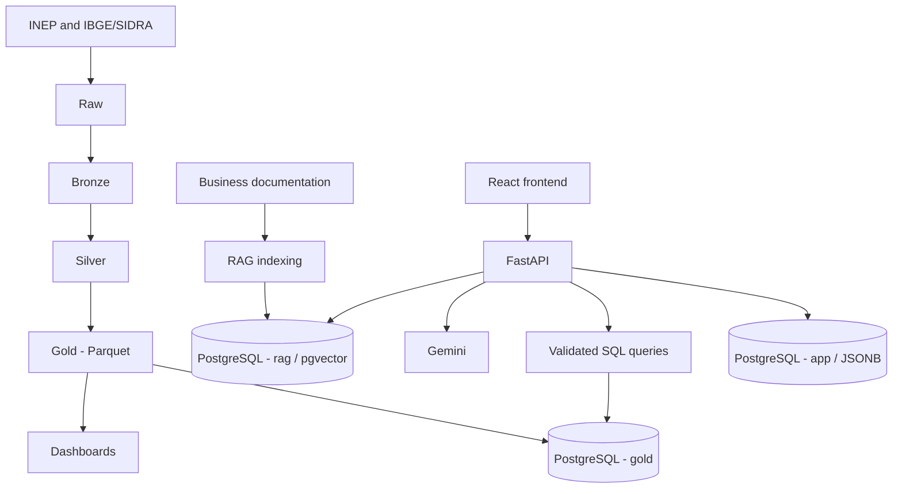

# EI DataBot

**[View Project](https://renanmrbraga.vercel.app/projects/ei-databot?utm_source=github&utm_medium=social&utm_campaign=portfolio&utm_content=ei_databot)**

**EI DataBot** is an experimental data engineering and analytics platform focused on Brazilian education. It brings together public datasets, interactive dashboards, and an AI-assisted chatbot for exploring educational indicators.

**Version:** `v0.1.1` · **Stage:** Alpha · **Environment:** Local development

> **Development status:** The platform is not ready for public deployment. Authentication, user-level access controls, and broader functional testing are still in development.

## About the Project

EI DataBot processes public education data from sources such as INEP and IBGE/SIDRA through a **Raw → Bronze → Silver → Gold** pipeline built with Python and Polars.

The processed data is stored in Parquet and published to PostgreSQL for analytical queries.

The platform also includes a React/TypeScript chatbot connected to FastAPI. Gemini interprets questions, while Python validates requests and runs predefined, parameterized SQL queries. RAG with pgvector provides supporting context from business documentation.

Dashboards and the chatbot share the same Gold data, but operate independently:

- **Dashboards:** use processed Gold Parquet files.
- **Chatbot:** queries analytical tables published in PostgreSQL.

## Current Features

The following results were validated during the Alpha 1 development cycle, on November 3, 2026.

| Component       | Implementation                                                        |
| --------------- | --------------------------------------------------------------------- |
| Data pipeline   | 27 ETL steps across Bronze, Silver, Gold, and dashboard generation    |
| PostgreSQL Gold | 5 dimensions, 5 fact tables, and 2,702,972 published records          |
| RAG             | Incremental indexing and retrieval from 5 business documents          |
| FastAPI         | Analytical queries, Gemini integration, RAG, and conversation history |
| React frontend  | Chat interface, conversation management, sources, and warnings        |
| Dashboards      | Educational visualizations generated from Gold data                   |
| Data quality    | Pipeline and database validations completed during Alpha 1            |

These figures describe a previously validated dataset, not live or continuously updated results.

## Technologies

| Area             | Technologies                                       |
| ---------------- | -------------------------------------------------- |
| Data engineering | Python, Polars, PyArrow, Parquet                   |
| Database         | PostgreSQL, JSONB, pgvector                        |
| Backend          | FastAPI, Pydantic, SQL                             |
| AI & RAG         | Gemini, embeddings, retrieval-augmented generation |
| Frontend         | React, TypeScript, Vite, Tailwind CSS              |
| Infrastructure   | Docker, Docker Compose                             |
| Testing          | Ruff, unittest, TypeScript, ESLint                 |

## Architecture



### Database Schemas

| Schema | Purpose                                              |
| ------ | ---------------------------------------------------- |
| `gold` | Analytical facts and dimensions produced by the ETL  |
| `rag`  | Documents, embeddings, metadata, and retrieval cache |
| `app`  | Conversation sessions and message history            |

The chatbot does not generate unrestricted SQL. Python validates the requested indicator, period, location, and operation before executing an authorized query.

Gemini helps interpret questions and explain results. **The database remains the source of numerical data.**

## Analytical Scope

The current chatbot supports two indicators:

| ID           | Indicator                   | Period    | Operations                  |
| ------------ | --------------------------- | --------- | --------------------------- |
| `CAT-EB-001` | Basic education enrollment  | 2018–2025 | `SOMA_ANUAL`, `SERIE_ANUAL` |
| `CAT-ES-023` | Higher education enrollment | 2018–2024 | `SOMA_ANUAL`, `SERIE_ANUAL` |

Queries can use supported periods and geographic filters. A state (UF) is required to identify municipalities unambiguously.

Some operations remain outside the current scope, including direct comparisons between municipalities. Higher education queries must also respect the geographic limitations of distance learning (EAD) data.

Requests outside the supported analytical contract are rejected rather than converted into unrestricted SQL.

### Geographic Distance

The educational ETL calculates approximate straight-line distances between municipalities using the Haversine formula.

The reference location is configurable through `CIDADE_REFERENCIA` and `UF_REFERENCIA` in `etl/educacao/config.py`.

Distances are stored in `gold.dim_localidade`, under `distancia_referencia_km`. The previously validated configuration uses Rio de Janeiro/RJ as its reference.

The dashboard receives these values, but an interactive distance filter is planned for a later version.

## RAG & Business Rules

Business documentation is stored in `docs/`. Five documents are indexed for retrieval:

| Document                                      | Content                                                    |
| --------------------------------------------- | ---------------------------------------------------------- |
| [Higher Education](docs/educacao_superior.md) | Enrollment, EAD, data sources, and geographic limitations  |
| [Basic Education](docs/educacao_basica.md)    | Schools, enrollment, and census methodology                |
| [Educational Assessments](docs/avaliacoes.md) | ENADE, CPC, IDD, IGC, and methodological rules             |
| [Indicators](docs/indicadores.md)             | Metrics, identifiers, and authorized operations            |
| [General Rules](docs/regras_gerais.md)        | Data granularity, traceability, and analytical constraints |

These documents remain in Portuguese to preserve the original business terminology.

The RAG pipeline uses `gemini-embedding-001` with 768-dimensional vectors. It supports incremental synchronization, reusing unchanged embeddings when possible.

Document indexing does not imply business-rule approval. Documents under review are excluded from normal retrieval unless explicitly enabled for testing.

RAG provides methodological context but cannot authorize additional SQL operations.

## Chatbot & Conversation History

The frontend supports analytical questions, follow-up messages, conversation switching, and deletion.

Messages are stored in PostgreSQL under the `app` schema. The browser maintains a local list of up to 50 known sessions, which can be restored through their UUIDs.

Previous messages, sources, and warnings can be retrieved. However, the current implementation does not reconstruct the original raw analytical data for older responses.

**Security limitation:** UUIDs identify sessions but do not provide authentication or authorization. The chatbot must remain in a controlled development environment until proper access controls are implemented.

## Running Locally

### Requirements

- Python 3.13
- Node.js and npm
- Docker and Docker Compose
- PostgreSQL with pgvector
- Gemini API credentials

Clone the repository:

```powershell
git clone https://github.com/renanmrbraga/ei_databot.git
Set-Location ei_databot
```

Install Python dependencies:

```powershell
python -m pip install -e ".[etl]"
```

Configure the required environment variables using `.env.example` as a reference. Keep passwords and API keys in a local, untracked `.env` file.

Before running the application, initialize PostgreSQL and the required schemas following the operational guide.

To inspect the data pipeline without executing it:

```powershell
python .\main.py --plan
```

The complete setup, database initialization, ETL commands, Docker procedures, and validation steps are documented in **[COMMANDS.md](COMMANDS.md)**.

> Running the ETL can overwrite processed files and replace published Gold tables. Review the operational guide and existing data before executing a full pipeline.

## Project Structure

```text
ei_databot/
├── chatbot/              # FastAPI and conversational services
├── dashboards/           # Gold-based dashboards
├── data/                 # Local datasets (not versioned)
├── docs/                 # Business rules and indicators
├── etl/                  # Raw, Bronze, Silver, and Gold pipelines
├── frontend/             # React, TypeScript, and Vite
├── health/               # Data and service health checks
├── postgres/             # Gold publishing, RAG, and history
├── tests/                # Python tests
├── main.py               # Data pipeline orchestrator
├── docker-compose.yml    # Local services
├── pyproject.toml        # Python configuration and dependencies
├── COMMANDS.md           # Operational guide
├── CHANGELOG.md          # Version history
├── LICENSE
└── README.md
```

## Limitations & Roadmap

EI DataBot remains experimental. The main priorities are:

- Implement authentication, authorization, and session isolation.
- Review database privileges and service credentials.
- Expand analytical tests, including yearly series, EAD, and invalid queries.
- Add municipality comparisons and richer chatbot outputs.
- Complete business-rule reviews and methodological validation.
- Improve deployment security, monitoring, and reliability.
- Expand the analytical interface and dashboard capabilities.

Gemini is an external service and may be subject to usage limits, latency, and temporary unavailability.

**The application is not approved for public deployment in its current state.**

## Versioning

The project follows [Semantic Versioning](https://semver.org/) using `MAJOR.MINOR.PATCH`.

The historical Alpha 1 tag is `v0.1.0-alpha.1`. The current documentation update uses `v0.1.1`.

While the project remains experimental, GitHub releases are marked as pre-releases.

See [CHANGELOG.md](CHANGELOG.md) for version history.

## Links

- [Project Page](https://renanmrbraga.vercel.app/projects/ei-databot?utm_source=github&utm_medium=social&utm_campaign=portfolio&utm_content=ei_databot)
- [Developer Portfolio](https://renanmrbraga.vercel.app/?utm_source=github&utm_medium=social&utm_campaign=portfolio&utm_content=ei_databot)
- [GitHub Profile](https://github.com/renanmrbraga)
- [LinkedIn](https://www.linkedin.com/in/renanmrbraga)

## License

Distributed under the [MIT License](LICENSE).
